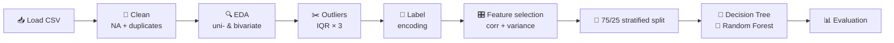

<div align="center">

# 🎬 Netflix Customer Churn Analytics

**Who is about to cancel, and what gives it away?**
An end-to-end churn analysis in R, from raw data to a Random Forest that catches **97%** of cancellations.


[Results](#-results) · [Insights](#-key-insights) · [Pipeline](#-pipeline) · [Explore the data](#-exploratory-analysis) · [Quick start](#-quick-start)

</div>

---

## ✨ At a Glance

| 👥 Customers | 📉 Churn rate | 🎯 Random Forest accuracy | 📈 Random Forest ROC-AUC |
|:---:|:---:|:---:|:---:|
| **5,000** | **50.3%** | **97.2%** | **0.996** |

> **The short version:** churn is driven by **disengagement**, not demographics. Customers who barely watch and haven't logged in for a month leave. Age, gender, region, device and favourite genre barely move the needle.

---

## 🎯 Project Goal

Subscription businesses lose revenue every time a customer cancels, and winning a customer back costs far more than keeping them. This project answers three questions:

1. **Who** is likely to churn?
2. **Which behaviours** signal it early enough to act on?
3. **How well** can a model predict it on customers it has never seen?

---

## 🗂️ Dataset

5,000 customer records with 14 columns (13 features plus the `churned` target). The classes are almost perfectly balanced: **2,515 churned (50.3%)** vs **2,485 retained (49.7%)**.

<details>
<summary><b>📖 Data dictionary (click to expand)</b></summary>

<br>

| Column | Type | Description |
|---|---|---|
| `customer_id` | ID | Unique identifier (dropped before modelling) |
| `age` | Numeric | Customer age, 18–70 |
| `gender` | Categorical | Female, Male, Other |
| `subscription_type` | Categorical | Basic, Standard, Premium |
| `watch_hours` | Numeric | Total hours watched (right-skewed, up to about 110) |
| `last_login_days` | Numeric | Days since last login, 0–60 |
| `region` | Categorical | Africa, Asia, Europe, North America, Oceania, South America |
| `device` | Categorical | Desktop, Laptop, Mobile, Tablet, TV |
| `monthly_fee` | Numeric | Three price points: 9, 14, 18 |
| `payment_method` | Categorical | Credit Card, Crypto, Debit Card, Gift Card, PayPal |
| `number_of_profiles` | Numeric | Profiles on the account, 1–5 |
| `avg_watch_time_per_day` | Numeric | Average daily watch time (extremely right-skewed) |
| `favorite_genre` | Categorical | Action, Comedy, Documentary, Drama, Horror, Romance, Sci-Fi |
| `churned` | **Target** | Whether the customer cancelled |

</details>

<!-- Add the dataset source / citation link here if the data is public. -->

---

## 🔧 Pipeline



| Step | What happens |
|---|---|
| **Cleaning** | Standardised column names, dropped ID and constant columns, removed rows with missing values and duplicates |
| **Outliers** | IQR rule with a 3× multiplier (extreme outliers only), plus a check that churners weren't removed disproportionately |
| **Encoding** | Categorical features label-encoded; target set to `Churned = 1`, `Retained = 0` |
| **No scaling** | Min-max scaling and log transforms were deliberately **not** applied. Tree-based models split on thresholds, so feature scale and skew don't affect them, and the splits stay readable in real units (hours, days, fee) |
| **Feature selection** | Dropped one of any pair with correlation above 0.90, and near-zero-variance features |
| **Split** | 75% train / 25% test, stratified on churn, fixed seed (`123`) |
| **Models** | Decision Tree (`rpart`) and Random Forest (`randomForest`, 500 trees) |
| **Metrics** | Accuracy, precision, recall, F1, ROC-AUC, evaluated on the 25% hold-out set with **Churned as the positive class** |

---

## 📊 Results

Evaluated on **1,159 unseen customers** (the 25% hold-out set).

| Model | Accuracy | Precision | Recall | F1 | ROC-AUC |
|---|:---:|:---:|:---:|:---:|:---:|
| 🌲 **Random Forest** | **0.972** | **0.981** | **0.967** | **0.974** | **0.996** |
| 🌳 Decision Tree | 0.886 | 0.907 | 0.881 | 0.893 | 0.901 |

The Random Forest wins on every metric. In plain terms: out of 628 customers who really did churn, it caught **607** and missed only **21**, while raising just **12** false alarms. The single decision tree missed 75 churners and raised 57 false alarms.

<table>
<tr>
<td align="center" width="50%">
<b>🌲 Random Forest</b><br>

</td>
<td align="center" width="50%">
<b>🌳 Decision Tree</b><br>

</td>
</tr>
</table>

<div align="center">

<br><sub><b>ROC curves:</b> Random Forest (AUC 0.996) vs Decision Tree (AUC 0.901)</sub>
</div>

### 🌲 The forest is stable

The out-of-bag error settles at roughly **3%** after about 300 trees, and it matches the test-set error. That is a good sign the model isn't just memorising the training data. Churned and Retained errors converge to the same level, so it isn't favouring one class.

<div align="center">

</div>

---

## 🌳 What the Decision Tree Learned

The tree is the easiest model to explain to a non-technical audience: just five questions separate most churners from most loyal customers.

<div align="center">

</div>

| Customer segment | Share of customers | Outcome |
|---|:---:|---|
| Watches **≥ 0.39 h/day** | 37% | 🟢 **90% retained** |
| Watches **< 0.39 h/day** and **last login ≥ 31 days ago** | 41% | 🔴 **91% churn** |
| Watches < 0.39 h/day, recent login, total **< 5 watch hours**, **< 4 profiles** | 9% | 🔴 **97% churn** |
| Same as above, but **≥ 4 profiles** and **fee < 11** | 2% | 🔴 **100% churn** |
| Same as above, but **≥ 4 profiles** and **fee ≥ 11** | 5% | 🟢 65% retained |
| Watches < 0.39 h/day, recent login, total **≥ 5 watch hours** | 5% | 🟢 88% retained |

---

## 💡 Key Insights

### 1. Engagement is the signal

The three strongest numeric links to churn are all behavioural:

| Feature | Correlation with churn |
|---|:---:|
| `watch_hours` | **−0.48** |
| `last_login_days` | **+0.47** |
| `avg_watch_time_per_day` | −0.27 |
| `number_of_profiles` | −0.16 |
| `monthly_fee` | −0.15 |
| `age` | 0.00 |

Churned customers last logged in about **41 days** ago at the median, versus about **19 days** for retained customers. Their median total watch time is about **4 hours** versus about **14 hours**.

### 2. Demographics don't matter

Churn rates for **gender, region, device and favourite genre** all sit within a few points of the 50.3% average, and age has zero correlation with churn. Targeting retention campaigns by demographic would be wasted effort.

### 3. Two business levers stand out

- **Subscription tier:** Basic customers churn at roughly **62%**, versus roughly 43–45% for Premium and Standard.
- **Payment method:** Crypto (about 60%) and Gift Card (about 58%) customers churn well above average, while Credit Card and Debit Card customers sit around 43–44%.

<div align="center">

<br><sub>Bars above the dashed line churn <i>more</i> than the 50.3% average</sub>
</div>

---

## 🚀 Recommended Actions

> These follow from the patterns above. They are hypotheses to test, since correlation does not prove cause.

| Priority | Action | Why |
|:---:|---|---|
| 🥇 | **Build an inactivity early-warning trigger.** Flag accounts approaching two weeks without a login or averaging under about 25 minutes of viewing per day | The tree shows a sharp cliff at 31 days of inactivity, so intervene *before* it |
| 🥈 | **Run win-back campaigns on disengaged users** with personalised recommendations or a "pick up where you left off" nudge | Low watch time plus a stale login is the clearest churn profile (91% churn) |
| 🥉 | **Target the Basic tier** with upgrade offers or retention incentives | Highest-churn plan by a wide margin |
| 4 | **Encourage recurring card or PayPal billing** over prepaid gift cards and crypto | Prepaid and crypto payers churn well above average, possibly because there's no automatic renewal |
| 5 | **Promote multi-profile and family use** | More profiles correlates with lower churn (r = −0.16) |

---

## 🔍 Exploratory Analysis

<details open>
<summary><b>Target, distributions and outliers</b></summary>

<br>

<table>
<tr>
<td align="center" width="50%">
<br>
<sub><b>Balanced target:</b> 50.3% churned vs 49.7% retained</sub>
</td>
<td align="center" width="50%">
<br>
<sub><b>Numeric distributions:</b> watch time features are heavily right-skewed</sub>
</td>
</tr>
<tr>
<td align="center">
<br>
<sub><b>Outlier check:</b> long tails in watch hours and daily watch time</sub>
</td>
<td align="center">
<br>
<sub><b>Categories:</b> every group is well represented</sub>
</td>
</tr>
</table>

</details>

<details open>
<summary><b>Relationships with churn</b></summary>

<br>

<table>
<tr>
<td align="center" width="50%">
<br>
<sub><b>Correlation heatmap:</b> watch hours and last login dominate</sub>
</td>
<td align="center" width="50%">
<br>
<sub><b>By churn status:</b> churners log in later and watch far less</sub>
</td>
</tr>
<tr>
<td align="center">
<br>
<sub><b>Watch hours vs last login:</b> churners cluster at low hours and long gaps</sub>
</td>
<td align="center">
<br>
<sub><b>Skewness check:</b> <code>avg_watch_time_per_day</code> is the most skewed feature</sub>
</td>
</tr>
</table>

</details>

---

## ⚠️ Limitations & Next Steps

Worth knowing before trusting the numbers:

- **The data looks unusually clean.** Near-uniform age and login distributions, a 50/50 class balance and three fixed price points suggest it may be simulated. Real-world churn is usually harder to predict, so expect lower scores on production data.
- **Data quality flag:** `avg_watch_time_per_day` reaches values near 100, which is impossible for hours in a day. It is probably a derived-feature artifact and should be checked at the source.
- **Preprocessing was fitted on the full dataset before splitting** (outlier bounds, correlation filter). The leakage is likely small, but a stricter setup would fit these steps on the training set only.
- **Label encoding** treats nominal categories (payment method, device) as ordered numbers. This is harmless for trees but would matter for linear models.
- **No hyperparameter tuning or cross-validation.** Both models use near-default settings and a single train/test split.

**Ideas for next steps:** k-fold cross-validation, tuning `mtry` and tree depth, gradient boosting (XGBoost / LightGBM), SHAP-based explanations, and a small Shiny dashboard that scores customers by churn risk.

---

## ⚡ Quick Start

**1. Clone the repo**

```bash
git clone https://github.com/<your-username>/<your-repo>.git
cd <your-repo>
```

**2. Get the data.** Either place `netflix_customer_churn.csv` in the project folder (used as the fallback), or set `DRIVE_FILE_ID` in the script to a Google Drive file shared as *Anyone with the link – Viewer*.

**3. Run the analysis in R**

```r
source("netflix_churn_analysis.R", echo = TRUE)
```

Missing packages install automatically. In RStudio you can also run the script section by section to see each plot as it's produced.

<details>
<summary><b>⚙️ Configuration options</b></summary>

<br>

All settings live in the `CONFIG` block at the top of the script:

| Setting | Default | Purpose |
|---|:---:|---|
| `TARGET_COL` | `"churned"` | Name of the churn column |
| `CHURN_VALUES` | `yes, y, true, 1, churned, ...` | Values that count as "churned" |
| `TRAIN_PROP` | `0.75` | Share of data used for training |
| `SEED` | `123` | Reproducibility |
| `OUTLIER_IQR_MULT` | `3` | `1.5` = strict, `3` = extreme outliers only |
| `CORR_CUTOFF` | `0.90` | Correlation above which a feature is dropped |
| `VAR_THRESHOLD` | `0.001` | Minimum variance to keep a feature |

</details>

---

## 🧰 Tech Stack

| Purpose | Packages |
|---|---|
| Data wrangling | `dplyr`, `tidyr` |
| Visualisation | `ggplot2`, `GGally`, `rpart.plot` |
| Modelling | `rpart`, `randomForest`, `caret`, `e1071` |
| Evaluation | `caret`, `pROC` |

---

## 📁 Repository Structure

```
.
├── netflix_churn_analysis.R      # Full pipeline: load → EDA → model → evaluate
├── netflix_customer_churn.csv    # Dataset (optional local fallback)
├── images/                       # Plots referenced in this README
└── README.md
```

---

<div align="center">

**If you found this useful, consider giving the repo a ⭐**

</div>
